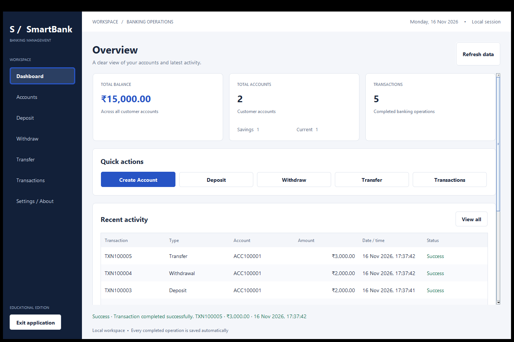

# Smart Banking Management System

## 1. Project overview

A Java internship project implementing **SmartBank**, a desktop banking workspace built with Swing. Create accounts, move money, search records, and restore balances and histories after restarting. Financial changes are planned as complete snapshots and persisted before becoming committed application state. The original console interface is also available.



## 2. Features

- Create, view and list savings and current accounts with validated customer details.
- Deposit, withdraw, transfer, check balances and inspect chronological account histories.
- Exact decimal money, sequential human-readable IDs and domain exceptions.
- UTF-8 text persistence with transfer pair validation and automatic recovery of interrupted snapshot writes.
- Nine-option console menu with safe invalid-input handling and graceful end of input.
- Desktop dashboard with live balances, account-type counts, recent activity and quick actions.
- Searchable, sortable account and transaction tables, customer details and copy-friendly receipts.
- Service-calculated previews, explicit financial confirmation, optional transfer descriptions and inline errors.
- Background loading/saving, safe file refresh, retry on startup failure and orderly shutdown.
- Automated business, persistence, failure-injection, console and desktop workflow tests.

## 3. Technologies

Java 17+, Swing/AWT, Core Java Collections, NIO, Time API and `BigDecimal`. Maven builds the executable JAR. JUnit Jupiter 5.11.4 is a **test-only** dependency; the running application has no external dependencies. No database, application framework or external banking API is used. Swing was chosen to retain Core Java compatibility and a portable single JAR without JavaFX runtime modules.

## 4. Architecture

**Frontend:** `Main` starts `MainWindow` on Swing's event dispatch thread. The window owns navigation and background tasks; `DashboardView`, `AccountsView`, `CreateAccountView`, `MoneyView` and `TransactionsView` present immutable service snapshots. `Theme` centralizes styling and `DataTable` provides shared read-only tables. Account details are part of `AccountsView`; one shared financial form handles deposits, withdrawals and transfers. `--console` starts the retained `BankingConsole` instead.

**Business layer:** `BankService` manages `AccountService`, `TransactionService` and their shared `BankStore`. It provides immutable `BankSnapshot` aggregates, counting a two-entry transfer once. `TransactionService.preview()` calculates proposed balances without writing or consuming IDs. Confirmed operations repeat backend validation before committing. The UI never calculates or mutates balances.

**Persistence layer:** `BankStore` owns the committed `LinkedHashMap`, checks ledger consistency, and coordinates persistence. `AccountFileHandler` and `TransactionFileHandler` encode and parse records. No view reads or writes banking files.

`BankStore` is necessary to commit account balances and the transaction ledger together. It also owns the data-directory lock. The application rejects a second process opening the same directory. Service operations synchronize on their shared store; this does not make the application a multi-user banking platform.

See [the class diagram](docs/class-diagram.md).

The desktop uses `SwingWorker` for startup, preview, save, refresh and close. Controls are disabled during a pending task, preventing duplicate submissions. Closing during a task waits for it to finish. Navigation uses cached immutable snapshots; repainting never reads a file. See [frontend design and verification](docs/frontend.md).

## 5. OOP concepts

### Abstraction

Abstract sealed `Account` exposes common operations and requires subclasses to implement `calculateInterest()` and `getAvailableFunds()`. Services operate on this common type.

### Encapsulation

Model fields are private. Customers and transaction records are immutable, and accounts are immutable snapshots. Account `deposit()` and `withdraw()` return validated candidate snapshots; they cannot alter the bank's committed map. There are no balance setters. History and account lists are immutable copies. Re-query `AccountService.findAccount()` after a service operation to obtain the latest snapshot.

### Inheritance

`SavingsAccount` and `CurrentAccount` inherit identity, customer, exact balance, history and common money operations from `Account`. Their rules remain in the model.

### Polymorphism

Services use `Account.deposit()`, `Account.withdraw()` and the overridden available-funds rule without separate savings/current transaction code. The console calls `calculateInterest()` through an `Account` reference: savings estimates 4% annual interest with `HALF_EVEN` rounding; current estimates zero. Interest is informational and is never automatically credited.

### Account policies

Both account types open at zero. Savings has no minimum balance or fees. Current exposes a fixed **INR 0.00 overdraft limit**: ordinary withdrawals and transfers cannot exceed deposited funds. Negative balances and unlimited overdrafts are forbidden. The zero limit deliberately follows the assignment's insufficient-balance examples; a future nonzero limit would require an explicit product-policy change and persisted configuration.

## 6. Collections used

`LinkedHashMap<String, Account>` maps account numbers to snapshots, supports direct lookup and preserves creation order for listings. `ArrayList<Transaction>` stores per-account histories and builds updated ledgers. Lists returned to callers are immutable. Sets detect duplicate customer IDs; ordered ledger validation rejects duplicate operation IDs.

## 7. Exception handling

`BankingException` is the application exception base. `InvalidAmountException`, `InsufficientBalanceException`, `AccountNotFoundException`, `ValidationException` and `PersistenceException` report actionable failures. Both interfaces show domain errors safely. The desktop offers retry for startup failures and a generic message for unexpected service errors. The console exits nonzero on startup failure. Normal users see no stack traces.

## 8. Persistence

The default directory is `data/`, relative to the working directory. An optional command-line path selects another directory. Missing directories/files are created. Files use UTF-8, pipe separators and one record per line. Blank lines are ignored. Pipes and control characters are rejected in customer text rather than escaped.

**accounts.txt — 7 fields**

```text
accountNumber|customerId|name|phone|email|accountType|balance
ACC100001|CUST100001|Alice|9876543210|alice@example.com|SAVINGS|5000.00
```

**transactions.txt — 9 fields**

```text
transactionId|transactionType|accountNumber|relatedAccountNumber|amount|timestamp|status|description|balanceAfterTransaction
TXN100001|DEPOSIT|ACC100001||10000.00|2026-11-16T10:30:00|SUCCESS|Cash deposit|10000.00
```

The account example illustrates a final balance; a real file must contain the complete ledger explaining that balance. Timestamps are ISO `LocalDateTime` in the machine's local timezone, without an offset.

A transfer creates consecutive `Transfer out` and `Transfer in` entries with the **same operation ID, amount and timestamp**, mirrored account references and separate resulting balances. Thus the ID identifies one successful operation, not each ledger line. Only `SUCCESS` entries are persisted; the `FAILED` enum exists for domain vocabulary but failed requests receive no ID or history entry.

Optional transfer descriptions are saved as `Transfer out: Monthly allocation` and `Transfer in: Monthly allocation`. Notes must match across the pair and contain at most 140 characters without pipes/control characters. The nine-field format and older records without notes remain compatible. The old three-argument `transfer()` API is retained.

Account numbers begin at `ACC100001`; customer IDs use the same suffix with `CUST`. Transaction operation IDs begin at `TXN100001`. The next number is derived from the largest stored suffix, so restarting never resets either sequence. No IDs are consumed by validation or pre-commit persistence failures. No delete/reset feature is provided.

### Commit and recovery protocol

1. Validate all inputs and calculate every resulting account snapshot without modifying committed state.
2. Validate the complete candidate ledger against balances, starting every account at zero.
3. Write a full snapshot to `pending.commit.tmp`, force its file contents, then atomically rename it to `pending.commit`. **This rename is the commit point.**
4. Publish the committed snapshot in memory, then atomically replace `accounts.txt` and `transactions.txt` from the journal. Remove the journal after both replacements succeed.
5. If step 3 fails, report failure and preserve balances, histories and ID sequences. If step 4 fails, the operation is already durably journaled: report its success and a recovery notice, retaining the journal. The next operation must complete recovery before creating another journal. Startup replays an intact journal before loading either snapshot file.

Temporary files from interrupted preparation are ignored and overwritten. Atomic moves must be supported in the data directory; there is no unsafe fallback. A persistent `bank.lock` file is normal; the OS lock is released on close/process exit.

Malformed records include the filename and line number in the error. Inconsistent balances, duplicate IDs, unknown account references, failed ledger entries and incomplete transfer pairs stop startup clearly and preserve data. The application **does not skip corrupt financial records**, since doing so could silently invent a balance. Back up and inspect the directory before repairing it. If no journal exists and a nonempty ledger or account snapshot is lost, consistency checking rejects the incomplete state.

Desktop **Refresh data** calls `BankService.refresh()` to recover and validate files while retaining the directory lock. Only a fully valid snapshot replaces the current one. A failed refresh keeps the last loaded data visible and blocks writes until a successful refresh. A reload cannot discard known accounts, truncate the ledger, or rewrite already loaded transactions.

## 9. Project structure

```text
src/main/java/com/banking/
  Main.java
  model/         Account, Customer, subclasses, Transaction, enums
  service/       AccountService, TransactionService, BankService, snapshot/preview records
  persistence/   BankStore, AccountFileHandler, TransactionFileHandler
  exception/     Domain exception hierarchy
  util/          Validators and sequential ID generators
  ui/            MainWindow, views, Theme, DataTable, BankingConsole
src/test/java/com/banking/  Business/persistence/console tests and ui/DesktopWorkflowTest
data/                      Empty initial text files
docs/                      UML, screenshots, desktop guide and verification matrices
scripts/maven.ps1          Maven bootstrap for Windows
pom.xml                    Build and test configuration
mvnw.cmd                   Windows build launcher
```

## 10. Setup

Install a **JDK 17 or newer** and put its `bin` directory on `PATH`. Confirm `java -version` and `javac -version`. A UTF-8 terminal and a font supporting `₹` are recommended. On Windows, `chcp 65001` enables UTF-8 in Command Prompt.

On Windows, the included launcher downloads Maven 3.9.9 into ignored `.tools/` on first use and verifies its SHA-512 against Maven Central. It uses the JDK selected on `PATH` when that Java executable is beside `javac.exe`, avoiding a stale `JAVA_HOME`. Internet access is needed for the initial Maven and test dependency downloads. No administrator installation is required.

On other systems, install Maven 3.9+ and set `JAVA_HOME` to your JDK 17+ installation. Use `mvn` in place of `.\mvnw.cmd` below. This project does not include a Unix bootstrap script.

## 11. Build

From the project root in PowerShell:

```powershell
.\mvnw.cmd clean verify
```

This compiles, runs tests and builds `target/smart-banking-management-system-1.0.0.jar`.

If an older application is holding the original JAR open, build in a separate directory:

```powershell
.\mvnw.cmd '-Dbanking.build.directory=target-desktop' '-Dbanking.guiTests=true' clean package
java -jar target-desktop/smart-banking-management-system-1.0.0.jar
```

The desktop release supplied in this workspace is in `target-desktop/`, because an existing console process had the original `target/` JAR open during verification. The build-directory override does not change the data directory. Close the existing console before opening its data in the GUI, or supply a separate data-directory argument.

## 12. Run

```powershell
java -jar target/smart-banking-management-system-1.0.0.jar
```

Optional separate data directory:

```powershell
java -jar target/smart-banking-management-system-1.0.0.jar "C:\bank-demo\data"
```

The default launch opens the desktop dashboard. Use the sidebar to navigate and **Exit application** or the window close button to exit. Every completed operation is saved immediately. The window waits for an in-flight operation before releasing resources.

To use the original console (also suitable for headless environments):

```powershell
java -jar target/smart-banking-management-system-1.0.0.jar --console
```

Both `--gui` and `--console` accept an optional data-directory argument after the flag. In the console, choose `9` or end input to exit. The same data directory cannot be open in both interfaces simultaneously.

## 13. Test

```powershell
.\mvnw.cmd test
```

JUnit uses `@TempDir`, never production `data/`. Tests assert exact balances, exception types, linked transfer entries, ID continuity and restored histories. Failure injection covers errors before the journal commit and between the two snapshot replacements. Console tests exercise menu validation, amount errors, end of input and the required banking flow across restart.

See [verification evidence and the requirement matrix](docs/verification.md). Surefire reports are generated under `target/surefire-reports/`.

Run the real desktop workflow tests on a machine with an interactive display:

```powershell
.\mvnw.cmd '-Dbanking.guiTests=true' clean test
.\mvnw.cmd package
```

The desktop tests drive actual Swing controls and modal dialogs on the event dispatch thread. They cover cancellation, the required funds flow, restart, errors, search/filter, compact layout, refresh repair, startup retry and closing during a worker. Rendered window captures are generated in `target/gui-evidence/`. Without the flag, these four display-dependent tests are explicitly skipped; the 73 service/console tests run normally. With the flag, all **77 tests** run.

## 14. Sample operations

Create savings A and current B. Deposit INR 10,000 into A and INR 5,000 into B. Withdraw INR 2,000 from A, then transfer INR 3,000 from A to B. The result is **A = INR 5,000.00 and B = INR 8,000.00**. Attempts to withdraw or transfer INR 10,000 from A fail without creating an ID or changing either account. Restart and inspect both balances and histories.

See [sample console output](docs/sample-output.md) and the complete captured [application transcript](docs/console-transcript.txt).

The desktop verification scenario adds another INR 2,000 deposit into A before withdrawing 2,000 and transferring 3,000. It finishes at **A = INR 7,000.00 and B = INR 8,000.00**, including after restart. A subsequent INR 20,000 transfer is rejected with both balances intact.

## 15. Edge cases

Names must be nonblank, at most 100 characters and contain no pipes/control characters. Phones contain 10–15 digits with an optional leading `+`. Email receives basic syntax validation, not delivery verification. Type accepts `SAVINGS` or `CURRENT` case-insensitively.

Amounts must be positive, at most INR 1,000,000,000.00 per operation and contain no more than two fractional digits. Console amounts use plain decimal notation, without grouping commas or exponent notation. Null amounts, NaN/Infinity strings, zero, negatives and excessive precision are rejected. Balances cannot exceed INR 1,000,000,000,000.00. Input precision is rejected rather than silently rounded; only interest estimates use rounding.

Unknown accounts, self-transfers, insufficient funds, malformed files, missing files and recovery cases are covered in [the audit](docs/verification.md).

## 16. Limitations

This is an educational simulation. It has no authentication, authorization, encryption, database, real payments or concurrent user support. Anyone with filesystem access can read personal details and alter records; consistency validation is not tamper-proof security.

The desktop requires a graphical environment, supports a minimum 980 × 700 logical-pixel window and has been verified on Windows. Large histories have horizontal table scrolling. Search/filter operate on the current service snapshot; refresh reloads files. Every account is displayed as Active because no account-closing lifecycle exists. Failed requests are shown as errors, not fabricated failed ledger entries. There is an Exit action rather than a simulated logout. No meaningless settings or authentication controls are included.

Snapshot writes and ledger replay favor clarity over performance and are intended for small internship datasets. Account history rebuilding copies lists. Backup/restore tooling, deletion, customer editing and interest posting are not implemented. Customer IDs are per account; this project does not model one customer sharing several accounts.

The journal protects against ordinary I/O failures and process interruption. Hardware loss, arbitrary file edits, cloud-sync conflicts, filesystem corruption and power-loss directory-metadata durability are outside its guarantees. Use a local directory for running data; avoid opening cloud-synced copies on multiple machines. File forcing and atomic rename do not provide database durability guarantees on every storage device. Deleting the entire data directory intentionally starts a new bank and therefore resets IDs.

## 17. Future improvements

Add authenticated roles, encrypted storage, backup/restore commands, account statements, configurable product rules and a more efficient append-only storage format. Any future nonzero overdraft or interest posting should include explicit policy and recovery tests.
