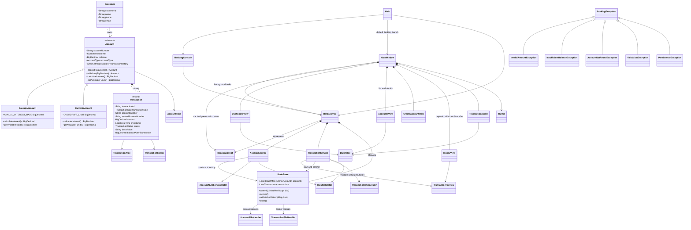

# Class diagram

Each account has one customer record in this exercise. A transfer has two immutable transaction entries, sharing one operation ID and referring to each other through their account numbers. Account operations produce candidate snapshots; only `BankStore` publishes committed state after journal persistence. Persistence flows through the shared store so both handlers participate in the same commit protocol.

The desktop owns a single `BankService`. Views delegate tasks through `MainWindow`; service I/O executes in `SwingWorker`, and presentation updates execute on the event dispatch thread. `MoneyView` obtains a `TransactionPreview`, opens an explicit confirmation, and only then invokes a banking operation. Both interfaces use the same services, model and files.
