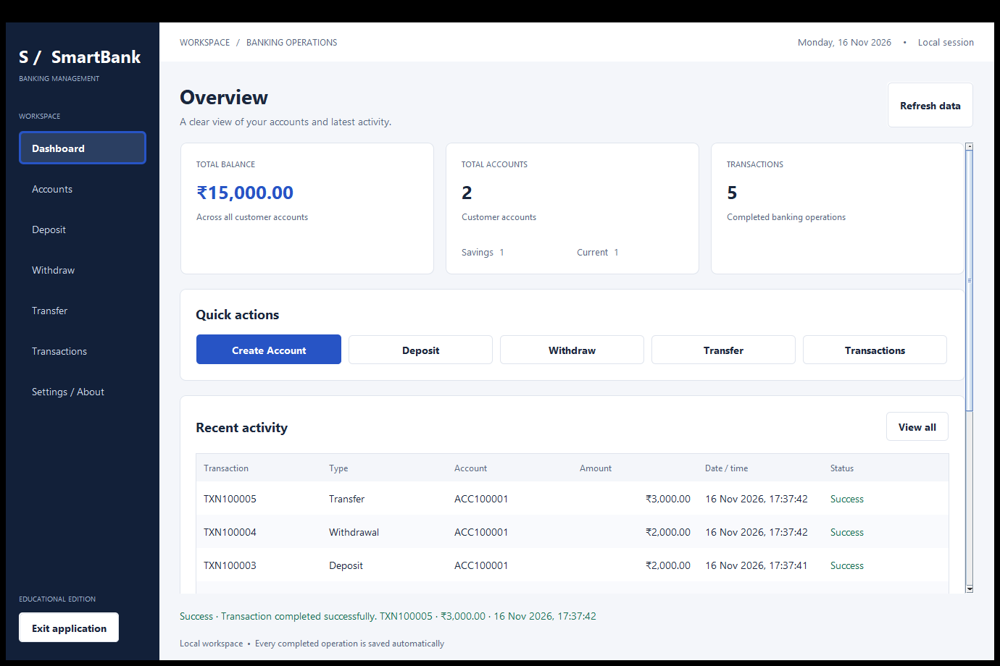
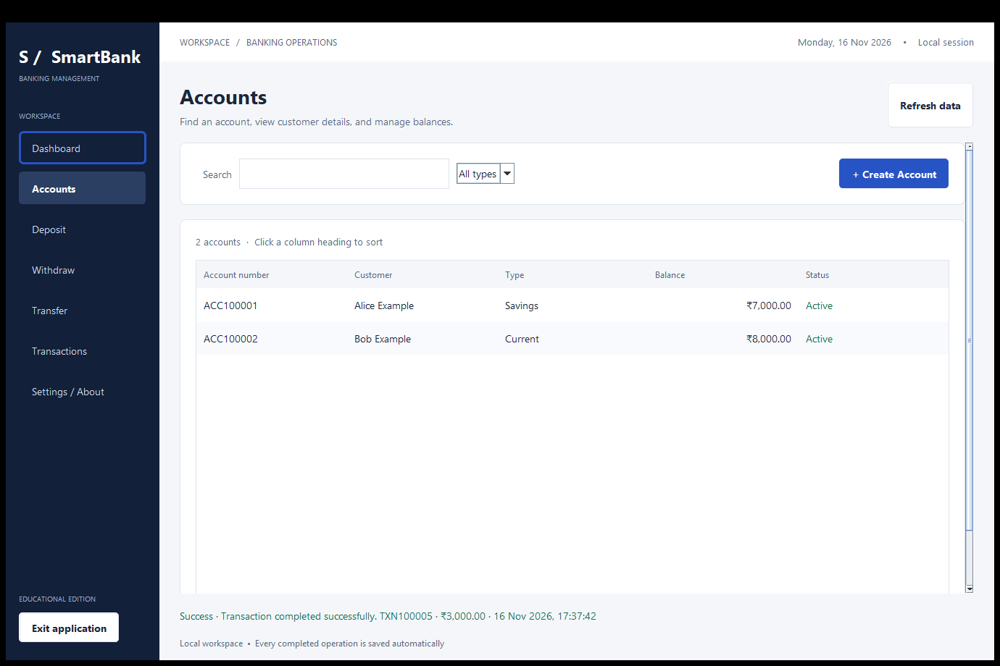
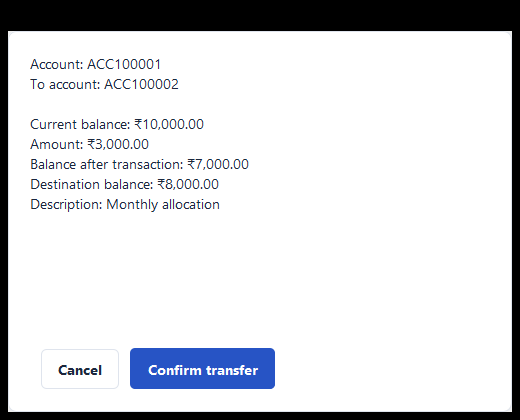
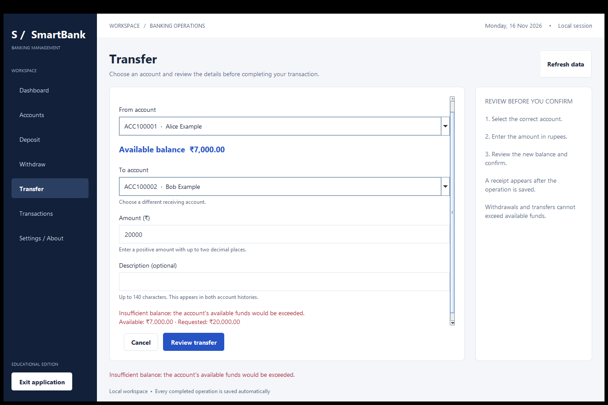
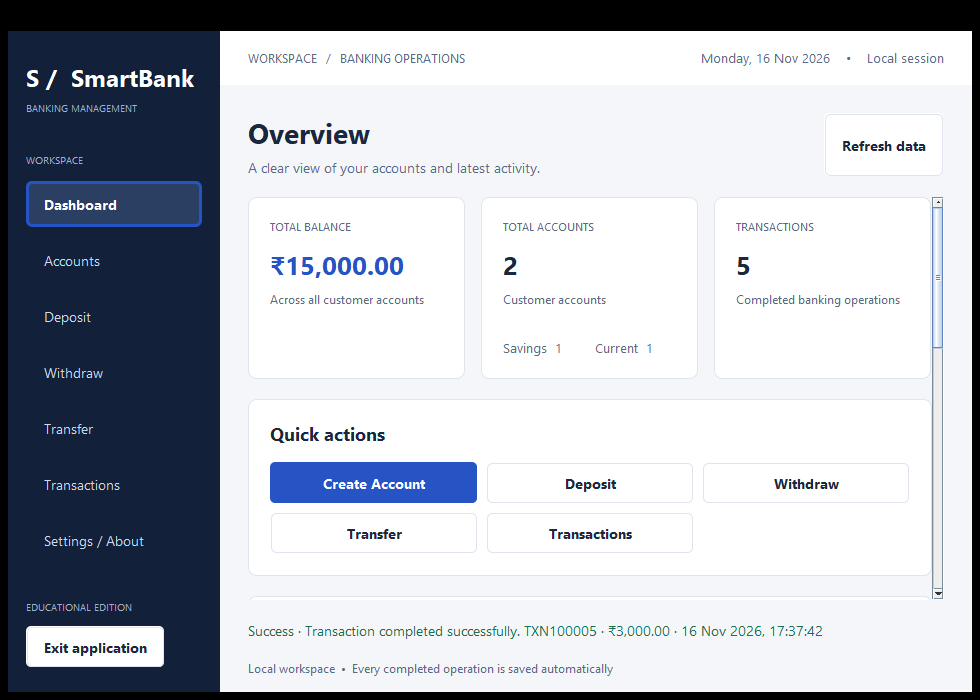

# Desktop frontend

## Design and architecture

SmartBank uses the JDK's Swing/AWT toolkit. The original Maven dependency list is unchanged; the executable JAR launches without a separate GUI runtime. A navy sidebar, neutral surfaces, blue actions and shared spacing/font tokens live in `Theme`. Status text accompanies color. Tables are read-only, keyboard accessible and sortable by their actual types, including decimal money and timestamps.

One window owns the banking service and a cached immutable `BankSnapshot`. Page navigation has no file I/O. `MainWindow.task()` runs one operation at a time in a `SwingWorker`, blocks duplicate user submissions, translates domain errors and updates widgets on the EDT. Closing waits for a pending worker and releases the store lock. Startup errors offer a retry action. The Settings/About page shows the version, actual data path, navigation help and simulation limitations.

`MoneyView` shares the financial input/review workflow across deposit, withdrawal and transfer. `TransactionService.preview()` is the authoritative source of proposed balances. A preview consumes no IDs, writes no files and changes no account. An explicit confirmation is required before executing any financial action; execution revalidates current state. Cancelling leaves balances and histories unchanged. Successful saves show a copy-friendly receipt and refresh the displayed service snapshot. Optional notes retain the outgoing/incoming direction in persisted transfer entries.

`BankService.snapshot()` calculates totals from the committed store and counts a transfer once. The dashboard shows five metrics: total balance, account total, savings count, current count and successful operation count. Savings/current counts are grouped in the account summary card. Recent activity shows one row per operation; full transaction history exposes both account entries for a transfer. Search matches actual accounts and ledger entries, never fixtures embedded in the UI.

Refresh reads and validates persistence through `BankService.refresh()`. If refresh fails, the last valid snapshot stays on screen; writes are blocked until a successful refresh. Known transaction history cannot be replaced with an older or rewritten ledger. The original journal commit/recovery protocol is preserved.

## Screenshots

These are captures of actual rendered Swing windows from desktop tests. Test accounts were created through the application against a temporary directory; they are not shipped as runtime data.











## Verification

All existing 69 tests remain unchanged and passing. Four additional service tests cover immutable previews and revalidation, aggregates, the new required balance flow, persisted notes, description validation, and refresh recovery. Four opt-in desktop tests exercise real `JFrame`, table, form, button and modal-dialog instances through the Swing EDT. This is automated desktop verification plus visual inspection of captured layouts, not a claim of an independent human usability study.

Commands used:

```powershell
.\mvnw.cmd -B -ntp '-Dbanking.build.directory=target-desktop' '-Dbanking.guiTests=true' clean test
.\mvnw.cmd -B -ntp '-Dbanking.build.directory=target-desktop' '-DskipTests' package
java -jar target-desktop/smart-banking-management-system-1.0.0.jar --gui <temporary-data-directory>
```

| Flow | Result / evidence |
|---|---|
| Launch empty workspace | Dashboard and actionable empty states |
| Create savings/current accounts | Real service-generated IDs and account details |
| Deposit into A/B | Receipts, balances, histories and dashboard refresh |
| Cancel a withdrawal | Balance remains 12,000; no transaction is created |
| Confirm withdrawal | Balance changes after confirmation only |
| Transfer with description | Both linked entries persisted with the same note |
| Mandatory funds flow | A: 10,000 + 2,000 − 2,000 − 3,000 = **7,000**; B: 5,000 + 3,000 = **8,000** |
| Restart desktop | Both balances and six ledger entries / five operations restored |
| Transfer 20,000 after restart | Rejected; A/B remain 7,000 / 8,000 |
| Same-account transfer | Inline error; no mutation |
| Insufficient withdrawal / nonnumeric amount | Clear errors; application remains usable |
| Account search | Name and customer ID produce matching real accounts |
| Account type filter | Savings/current filters work with displayed results |
| Transaction search/type filter | Description finds two transfer entries; deposit filter finds none |
| Account details | Customer fields, balance, recent history, working actions |
| Refresh | Reloads files and updates current page; corruption retains prior state |
| Repair after refresh failure | Subsequent valid reload succeeds |
| Startup corruption | Retry screen; repair/retry opens dashboard |
| Unexpected service exception | Generic user message; navigation remains usable |
| Settings/About | Displays actual data path and application information |
| Close during a worker | Waits for completion and releases storage lock |
| Resize | 1380 × 920 and 980 × 700 inspected; actions wrap, forms scroll with visible footer buttons |

The packaged GUI was also launched separately and closed through its native window-close path. The retained console was checked through `--console`. Original production data files remain empty.

The clean test command ran **77 tests with 0 failures, 0 errors and 0 skips**. The subsequent packaging command reused those tested classes and skipped repeating the suite. The separate desktop process reported a responsive SmartBank window and exited with code 0 after a native close request; the console then reopened the same smoke-test directory, confirming release of the file lock.

An existing console process held the original `target/` JAR open. The final clean/test/package verification therefore used the configurable `target-desktop/` build directory, leaving that session running. Reports and fresh GUI captures from the final build are under `target-desktop/`.

## Manual review checklist

For an evaluator repeating the demonstration:

1. Build and launch the JAR; use a fresh optional data directory.
2. Create Alice (Savings) and Bob (Current). Search each by account number, name and customer ID.
3. Deposit 10,000 into Alice and 5,000 into Bob; deposit another 2,000 into Alice.
4. Review a 2,000 withdrawal, cancel it, then repeat and confirm. Observe receipts and history.
5. Transfer 3,000 from Alice to Bob with a description. Inspect both account entries.
6. Exit, restart with the same directory, and verify 7,000 / 8,000 and the restored history.
7. Attempt a 20,000 transfer, a self-transfer and an invalid amount; verify clear errors and unchanged balances.
8. Check filters, column sorting, Refresh data and account details. Resize to the minimum window size and use Tab/Enter navigation.

## Intentional limits

There is no authentication/session system, so Exit is the truthful session-ending action. Account status is Active for all existing accounts because there is no closing feature. Failed requests never become persisted transactions. The UI is a local educational administration tool and makes no production banking-security claims. Windows was tested; other JDK desktop platforms may render fonts and decorations differently. Screenshots exclude native OS decoration when Swing itself paints the capture.
